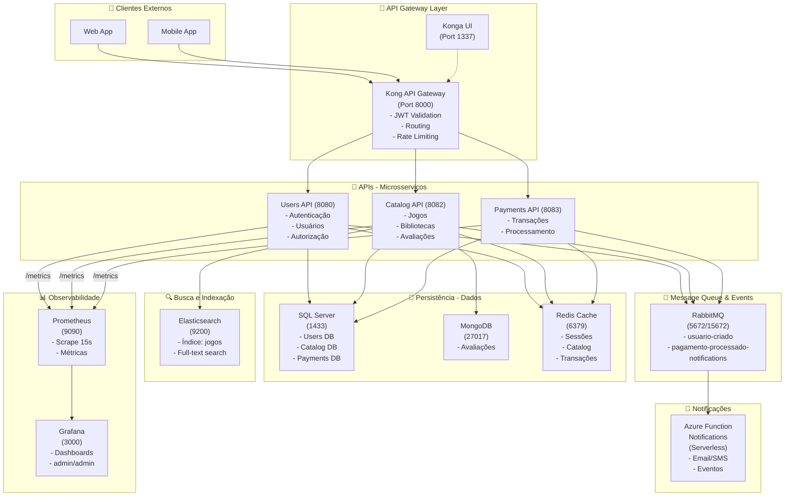
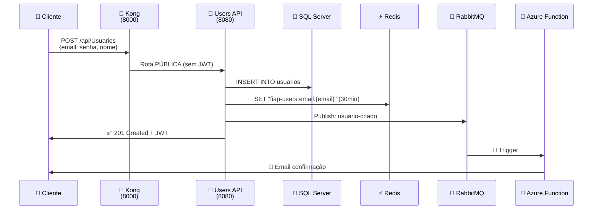
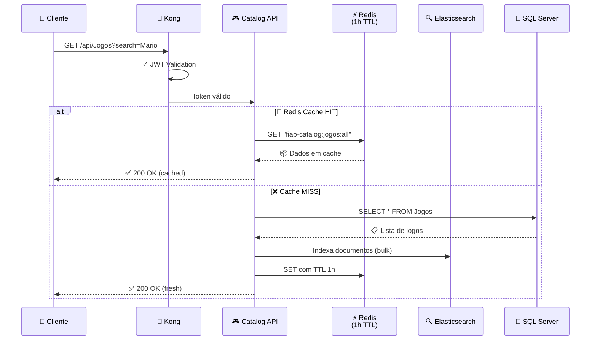
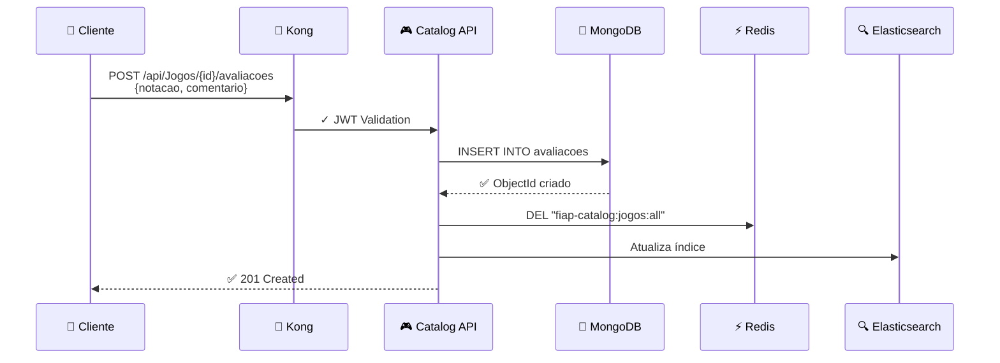
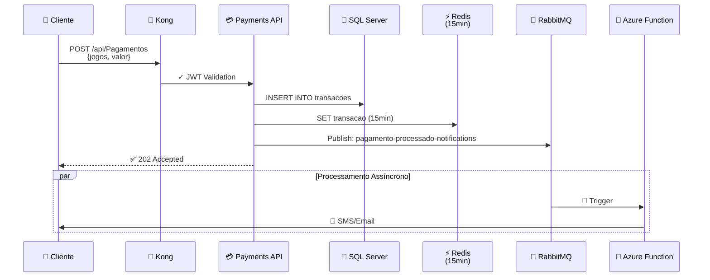
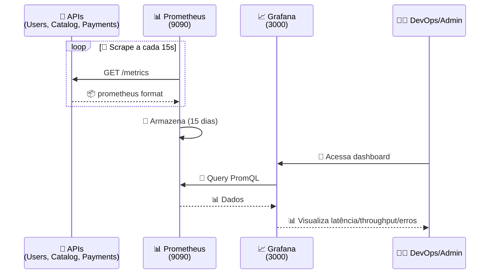

# FIAP Orchestration

Repositório centralizado de orquestração para os projetos FIAP Cloud Games.

**Suporta duas formas de deploy:**
- **Docker Compose**: Para desenvolvimento local rápido (`docker-compose up`)
- **Kubernetes**: Para ambientes de produção e testes avançados

**Cada projeto mantém seus próprios manifestos Kubernetes em sua pasta `/k8s`. Este repositório apenas orquestra e executa todos os recursos de forma centralizada.**

---

## 🎯 O que é Orquestração?

O `fiap-orchestration` é o **coração central** que coordena toda a arquitetura. Ele não executa lógica de negócio, mas gerencia:

- ✅ Todas as **APIs** (Users, Catalog, Payments)
- ✅ Toda **infraestrutura compartilhada** (Databases, Cache, Message Broker)
- ✅ **Observabilidade** (Prometheus + Grafana)
- ✅ **Ferramentas de desenvolvimento** (LocalStack, Kong)

Tudo sobe com um único comando: `docker-compose up -d --build`

---

## 🏗️ Visão Geral - Arquitetura Centralizada

```
┌─────────────────────────────────────────────────────────────────┐
│                  FIAP ORCHESTRATION (Central)                   │
├─────────────────────────────────────────────────────────────────┤
│                                                                 │
│  📂 docker-compose.yml - Orquestra tudo:                       │
│     ├── 🏛️ INFRAESTRUTURA COMPARTILHADA                         │
│     │   ├── Kong (API Gateway - Port 8000)                    │
│     │   ├── PostgreSQL (Kong DB)                              │
│     │   ├── RabbitMQ (Message Broker - 5672/15672)           │
│     │   ├── SQL Server (Dados principais - 1433)             │
│     │   ├── Redis (Cache distribuído - 6379)                 │
│     │   ├── MongoDB (NoSQL Avaliações - 27017)               │
│     │   └── Elasticsearch (Full-text search - 9200)          │
│     │                                                           │
│     ├── 🚀 MICROSSERVIÇOS (build dinâmico)                     │
│     │   ├── fiap-users-api (8080)                            │
│     │   ├── fiap-catalog-api (8082)                          │
│     │   ├── fiap-payments-api (8083)                         │
│     │   └── fiap-notifications-function (Azure, fora docker) │
│     │                                                           │
│     ├── 📊 OBSERVABILIDADE                                     │
│     │   ├── Prometheus (9090 - Scrape 15s)                   │
│     │   └── Grafana (3000 - Dashboards)                      │
│     │                                                           │
│     └── 🔧 FERRAMENTAS DE GERENCIAMENTO                       │
│         └── Konga (1337 - Kong UI Management)                │
│                                                                 │
└─────────────────────────────────────────────────────────────────┘
```

---

## 🌐 Diagrama Completo de Fluxos



---

## 🔄 Fluxos por Caso de Uso

### **1️⃣ Cadastro de Usuário** (Sync → Async)



### **2️⃣ Listar Jogos** (Cache + Elasticsearch)



### **3️⃣ Criar Avaliação** (Jogo → MongoDB)



### **4️⃣ Processar Pagamento** (Async com Notificação)



### **5️⃣ Observabilidade** (Métricas → Dashboard)



---

## 📋 Matriz de Endpoints

| Endpoint | Método | Acesso | Banco | Cache | Message | Observação |
|----------|--------|--------|-------|-------|---------|-----------|
| `/api/Usuarios` | POST | 🔓 Público | SQL | — | usuario-criado | Cadastro |
| `/api/Usuarios/login` | POST | 🔓 Público | SQL | Redis | — | Emite JWT |
| `/api/Usuarios` | GET | 🔒 JWT | SQL | Redis | — | Listar users |
| `/api/Usuarios/{id}` | GET/PATCH/DELETE | 🔒 JWT | SQL | Redis | — | Detalhes user |
| `/api/Jogos` | GET | 🔒 JWT | SQL | Redis | — | Cache 1h, ES |
| `/api/Jogos?search=` | GET | 🔒 JWT | ES | Redis | — | Full-text search |
| `/api/Jogos` | POST | 🔒 JWT | SQL | — | — | Indexa ES |
| `/api/Jogos/{id}/avaliacoes` | POST | 🔒 JWT | MongoDB | — | — | Limpa cache |
| `/api/Jogos/{id}/avaliacoes` | GET | 🔒 JWT | MongoDB | — | — | Avaliações |
| `/api/Pagamentos` | POST | 🔒 JWT | SQL | Redis | pagamento-processado-notifications | Cria transação |
| `/api/Pagamentos` | GET | 🔒 JWT | SQL | Redis | — | Listar |
| `/metrics` | GET | 🔓 Público | — | — | — | Prometheus scrape |
| `/health` | GET | 🔓 Público | — | — | — | Health check |

---

## 🔍 Busca e Indexação (Elasticsearch)

### **Elasticsearch** (Port 9200)

Elasticsearch está integrado ao **Catalog API** para full-text search de jogos.

**Configuração:**
```yaml
Elasticsearch:
  Url: "http://elasticsearch:9200"
  Index: "jogos"
```

**Índice: jogos**
```
Campos indexados:
├── nome (text + keyword)
├── descricao (text)
├── genero (keyword)
├── preco (number)
└── dataLancamento (date)

Sincronização:
├─ Trigger: POST/PUT/DELETE /api/Jogos
├─ Operação: Bulk index/update/delete
└─ Fallback: SQL query se ES indisponível
```

**Query Exemplo:**
```bash
curl -X GET "http://localhost:9200/jogos/_search" \
  -H "Content-Type: application/json" \
  -d '
{
  "query": {
    "multi_match": {
      "query": "Mario",
      "fields": ["nome", "descricao"]
    }
  }
}'
```

---

## 🚀 Início Rápido

### Local (Docker Compose)
```bash
# 1. Iniciar todos os serviços
docker-compose up -d

# 2. Aguardar Kong estar pronto (~30 segundos)
# Verificar: curl http://localhost:8001/status

# 3. Configurar serviços e rotas Kong (ver seção Kong Setup abaixo)

# 4. Testar roteamento com curl (ver seção Kong Routing Tests abaixo)
```

### Pontos de Acesso
- **Kong Gateway (Proxy)**: http://localhost:8000 ← **Use AQUI para requisições**
- **Kong Admin API**: http://localhost:8001 ← Apenas gerenciamento
- **Konga (Gerenciador Kong)**: http://localhost:1337
- **Prometheus**: http://localhost:9090
- **Grafana**: http://localhost:3000 (user: admin, password: admin)
- **RabbitMQ**: http://localhost:15672 (user: admin, password: <senha do .env>)
- **Elasticsearch**: http://localhost:9200
- **Serviços** (via Kong Gateway na porta 8000):
  - Users: http://localhost:8000/api/Usuarios
  - Catalog (Jogos): http://localhost:8000/api/Jogos
  - Catalog (Bibliotecas): http://localhost:8000/api/Bibliotecas
  - Payments: http://localhost:8000/api/Pagamentos
- **Métricas Diretas** (bypass Kong):
  - Users API: http://localhost:8080/metrics
  - Catalog API: http://localhost:8082/metrics
  - Payments API: http://localhost:8083/metrics
  - Notifications: Azure Function local (`func start` no repo `fiap-notifications-function`)

### Kong Setup (Declarativo via decK)

A configuração do Gateway (services, routes, plugins, consumers) é **versionada** em
[`k8s/kong/kong.yml`](k8s/kong/kong.yml) e aplicada com [decK](https://docs.konghq.com/deck/):

```bash
# Verificar se Kong está pronto
curl http://localhost:8001/status

# Ver o que seria alterado (não aplica nada)
deck diff --kong-addr http://localhost:8001 -s k8s/kong/kong.yml

# Aplicar a configuração (cria/atualiza/remove para bater com o arquivo)
deck sync --kong-addr http://localhost:8001 -s k8s/kong/kong.yml
```

Isso substitui os passos manuais via `curl` usados anteriormente: agora rotas e
plugins nascem e são recriados a partir do arquivo, então o estado do Kong nunca
fica só "na memória" do Postgres do container.

> ⚠️ Pagamentos e Notificações ainda não têm rota no Gateway: Payments não tem
> controllers HTTP implementados (só `/health` e `/metrics`) e Notifications está
> migrando para arquitetura serverless. Quando isso mudar, adicionar os services/routes
> correspondentes em `kong.yml`.

#### ⚠️ Importante: strip_path: false

Por padrão, Kong remove o prefixo do path antes de encaminhar à API (ex: `/api/Usuarios` vira `/`). Como nossas APIs esperam o path completo (`/api/Usuarios`), **sempre use `strip_path: false`** nas rotas.

---

## 📊 Observabilidade (Prometheus + Grafana)

### Arquitetura

```
┌──────────────────────────────────────────────────────────┐
│                   Aplicações (.NET)                      │
│  ┌──────────┐  ┌──────────┐  ┌──────────┐              │
│  │ Users    │  │ Catalog  │  │ Payments │              │
│  │ API      │  │ API      │  │ API      │              │
│  │ :8080    │  │ :8080    │  │ :8080    │              │
│  │/metrics  │  │/metrics  │  │/metrics  │              │
│  └──────────┘  └──────────┘  └──────────┘              │
│       ↓               ↓               ↓                  │
└──────────────────────────────────────────────────────────┘
              ↓
        ┌──────────────┐
        │  Prometheus  │
        │  :9090       │
        │ (scrapes)    │
        └──────────────┘
              ↓
        ┌──────────────┐
        │   Grafana    │
        │  :3000       │
        │ (visualiza)  │
        └──────────────┘
```

### Instrumentation nos Serviços

Todos os 4 serviços foram instrumentados com **prometheus-net.AspNetCore v8.2.1**:

1. **Users API** ✅
2. **Catalog API** ✅
3. **Payments API** ✅
4. **Notifications API** ✅

Cada serviço expõe métricas no endpoint `/metrics`:
```bash
curl http://localhost:8080/metrics      # Users
curl http://localhost:8082/metrics      # Catalog
curl http://localhost:8083/metrics      # Payments
curl http://localhost:8081/metrics      # Notifications
```

### Métricas Coletadas

**HTTP Requests:**
- `http_request_duration_seconds` - Latência de requisições
- `http_requests_total` - Total de requisições por status code

**Exemplos de Query Prometheus:**
```promql
# P95 Latência
histogram_quantile(0.95, rate(http_request_duration_seconds_bucket[5m]))

# Taxa de requisições (throughput)
rate(http_requests_total[5m])

# Taxa de erros 5xx
rate(http_requests_total{status=~"5.."}[5m])

# Taxa de erros 4xx
rate(http_requests_total{status=~"4.."}[5m])
```

### Grafana Dashboards

**Dashboard Pré-configurado:** `FIAP Cloud Games - Observabilidade`

**Painéis Inclusos:**
1. **Latência de Requisições HTTP (Percentis)** - P95 e P99 por serviço
2. **Taxa de Requisições (Throughput)** - Requisições/s por método
3. **Taxa de Erros HTTP** - Erros 4xx e 5xx separados
4. **Distribuição de Status HTTP** - Pizza com distribuição de status codes

**Acesso:**
- URL: http://localhost:3000
- Usuário: `admin`
- Senha: `admin`

**Importar Dashboard Customizado:**
1. Abrir Grafana (http://localhost:3000)
2. Dashboard → New → Import
3. Colar JSON ou fazer upload de `grafana/provisioning/dashboards/fiap-observabilidade.json`

### Configuração Prometheus

**Arquivo:** `prometheus.yml`

**Scrape Targets:**
- `users-api:8080/metrics` - Interval: 10s
- `catalog-api:8080/metrics` - Interval: 10s
- `payments-api:8080/metrics` - Interval: 10s
- `notifications-api:8080/metrics` - Interval: 10s
- `rabbitmq:15692/metrics` - Interval: 15s
- `kong:8001/metrics` - Interval: 15s

**Retention:** 15 dias (padrão do Prometheus)

### Logs Estruturados (Serilog)

Todos os serviços usam **Serilog** para logging estruturado:

```csharp
Log.Logger = new LoggerConfiguration()
    .ReadFrom.Configuration(builder.Configuration)
    .Enrich.FromLogContext()
    .CreateLogger();
```

**Sinks Configurados:**
- Console (stdout)
- File (arquivo local)

**CorrelationId:** Rastreamento de requisições distribuído automaticamente

### Alertas Futuros

Para ativar alertas no Prometheus:

1. Criar arquivo `alerting-rules.yml`:
```yaml
groups:
  - name: fiap-alerts
    rules:
      - alert: HighErrorRate
        expr: rate(http_requests_total{status=~"5.."}[5m]) > 0.05
        for: 5m
        annotations:
          summary: "Alta taxa de erros em {{ $labels.service }}"
```

2. Referenciar em `prometheus.yml`:
```yaml
rule_files:
  - /etc/prometheus/alerting-rules.yml
```

---

## 💾 Cache Distribuído (Redis)

### Arquitetura

```
┌──────────────────────────────────────────────────────────┐
│              Aplicações com Cache (.NET)                 │
│  ┌──────────────┐  ┌──────────────┐  ┌──────────────┐   │
│  │ Users API    │  │ Catalog API  │  │ Payments API │   │
│  │ :8080        │  │ :8080        │  │ :8080        │   │
│  │ RedisUsuario │  │ RedisJogo    │  │ RedisTransacao
│  │ (sessões)    │  │ (cache)      │  │ (cache)      │   │
│  └──────────────┘  └──────────────┘  └──────────────┘   │
│       ↓                 ↓                  ↓              │
└──────────────────────────────────────────────────────────┘
              ↓
        ┌──────────────┐
        │   Redis 7    │
        │   :6379      │
        │ (cache dist) │
        └──────────────┘
```

### Implementação em Todas as APIs ✅

#### 1. **Users API** - Sessões de Usuário
- **Cache**: `fiap-users:sessao:{usuarioId}` + `fiap-users:email:{email}`
- **TTL**: 30 minutos (configurável)
- **Fallback**: MemoryCache (quando Redis está indisponível)
- **Caso de Uso**: Validar sessões ativas, autenticação rápida

#### 2. **Catalog API** - Catálogo de Jogos
- **Cache**: `fiap-catalog:jogos:all` (lista completa) + `fiap-catalog:jogo:{jogoId}` (individual)
- **TTL**: 1 hora (configurável)
- **Fallback**: MemoryCache
- **Caso de Uso**: Reduzir queries repetidas ao banco de dados

#### 3. **Payments API** - Transações
- **Cache**: `fiap-payments:transacao:{transacaoId}` (detalhes da transação)
- **TTL**: 15 minutos (configurável)
- **Fallback**: MemoryCache
- **Caso de Uso**: Acelerar consulta de status de pagamento

### Testar Redis

```bash
# Conectar ao Redis CLI
docker exec -it redis redis-cli

# Ver todas as chaves
KEYS "*"

# Ver tamanho do cache
DBSIZE

# Ver valor específico (ex: Jogos)
HGETALL "fiap-catalog:jogos:all"

# Ver TTL de uma chave
TTL "fiap-catalog:jogos:all"

# Limpar tudo (cuidado!)
FLUSHALL

# Sair
exit
```

### Configuração em `appsettings.json`

```json
{
  "Cache": {
    "Redis": {
      "Host": "redis",
      "Port": 6379,
      "Enabled": true,
      "TTLSeconds": 3600
    }
  }
}
```

### Verificação de Funcionamento

1. **Criar dados** (ex: novo jogo no CatalogAPI)
   ```bash
   curl -X POST http://localhost:8000/api/Jogos \
     -H "Content-Type: application/json" \
     -d '{"nome": "Elden Ring", "preco": 299.90}'
   ```

2. **Validar cache populado**
   ```bash
   docker exec redis redis-cli HGETALL "fiap-catalog:jogos:all"
   ```

3. **Validar TTL**
   ```bash
   docker exec redis redis-cli TTL "fiap-catalog:jogos:all"
   # Deve retornar um número entre 0 e 3600
   ```

---

## 🗄️ Persistência NoSQL (MongoDB)

### Arquitetura

```
┌──────────────────────────────────────────────────────────┐
│                   Catalog API (.NET)                     │
│    Avaliações de Jogos (dados não-estruturados)         │
│                                                           │
│  ┌────────────────────────────────────────────┐          │
│  │   AvaliacaoDocument (Modelo MongoDB)       │          │
│  │   - id (ObjectId)                          │          │
│  │   - jogoId (Guid)                          │          │
│  │   - usuarioId (Guid)                       │          │
│  │   - notacao (1-10)                         │          │
│  │   - comentario (string)                    │          │
│  │   - dataCriacao (DateTime)                 │          │
│  └────────────────────────────────────────────┘          │
│                     ↓                                     │
└──────────────────────────────────────────────────────────┘
              ↓
        ┌──────────────────┐
        │    MongoDB 7     │
        │    :27017        │
        │ Collection:      │
        │ avaliacoes       │
        │ (index: jogoId)  │
        └──────────────────┘
```

### Implementação ✅

**Projeto**: `FiapCloudGames.Catalogs.Infrastructure`

**Componentes**:
- `AvaliacaoDocument` - Modelo BSON com mapping automático
- `AvaliacaoRepository` - Interface para CRUD
- Índice `JogoId` para queries rápidas
- Registrado em `Program.cs` via Dependency Injection

### Testar MongoDB

```bash
# Conectar ao MongoDB
docker exec -it mongodb mongosh --username admin --password <senha do .env>

# Listar bancos
show dbs

# Usar banco fiap-catalog
use fiap-catalog

# Ver coleções
show collections

# Buscar todas as avaliações
db.avaliacoes.find()

# Buscar avaliações de um jogo específico
db.avaliacoes.find({ "jogoId": ObjectId("...") })

# Contar total de avaliações
db.avaliacoes.countDocuments()

# Ver índices
db.avaliacoes.getIndexes()

# Sair
exit
```

### Endpoints de Avaliacoes

**Criar avaliação:**
```bash
curl -X POST http://localhost:8000/api/Jogos/{jogoId}/avaliacoes \
  -H "Content-Type: application/json" \
  -d '{
    "usuarioId": "123e4567-e89b-12d3-a456-426614174000",
    "notacao": 9,
    "comentario": "Jogo excelente!"
  }'
```

**Listar avaliações de um jogo:**
```bash
curl http://localhost:8000/api/Jogos/{jogoId}/avaliacoes
```

**Listar todas as avaliações:**
```bash
curl http://localhost:8000/api/Avaliacoes
```

---

### ✅ JWT Plugin Kong (Ativo)

O plugin `jwt` está configurado em `k8s/kong/kong.yml` nas rotas protegidas de
Users API (exceto cadastro/login) e Catalog API (Jogos, Bibliotecas). Um
Consumer (`fcg-users-api`) guarda a credencial JWT com o **mesmo** `key`
(= `Jwt:Issuer`) e `secret` (= `Jwt:Key`) usados pela Users API para assinar o
token (HS256), então o Kong valida a assinatura sem precisar reimplementar nada.

**Rotas públicas (sem token):**
- `POST /api/Usuarios` (cadastro)
- `POST /api/Usuarios/login` (login, emite o token)

**Rotas protegidas (exigem `Authorization: Bearer <token>`):**
- `GET/PATCH/PUT/DELETE /api/Usuarios/*` (ex.: tornar-admin)
- `GET/POST/PUT/DELETE /api/Jogos/*`
- `GET/POST/DELETE /api/Bibliotecas/*`

```bash
# 1. Login (rota pública) e captura do token
TOKEN=$(curl -s -X POST http://localhost:8000/api/Usuarios/login \
  -H "Content-Type: application/json" \
  -d '{"email":"usuario@teste.com","senha":"senha123"}' | jq -r .token)

# 2. Sem token -> 401 Unauthorized
curl -i http://localhost:8000/api/Jogos

# 3. Com token -> 200 OK
curl -i http://localhost:8000/api/Jogos -H "Authorization: Bearer $TOKEN"
```

---

### Testes de Roteamento Kong
```bash
# Verificar Kong proxy - Users API
curl http://localhost:8000/api/Usuarios

# Verificar Kong admin
curl http://localhost:8001/status

# Listar serviços
curl http://localhost:8001/services

# Listar rotas
curl http://localhost:8001/routes

# Testar roteamento Users API
curl http://localhost:8000/api/Usuarios/health

# Testar roteamento Catalog API - Jogos
curl http://localhost:8000/api/Jogos

# Testar roteamento Catalog API - Bibliotecas
curl http://localhost:8000/api/Bibliotecas
```

---

## 📁 Estrutura

```
fiap-orchestration/              # Este repositório (orquestrador)
├── docker-compose.yml           # Orquestração Docker (dev local)
├── k8s/
│   ├── base/
│   │   └── namespace.yaml       # Namespace compartilhado
│   ├── kong/
│   │   ├── values.yaml          # Helm chart values para Kong
│   │   ├── configmap.yaml       # Configuração Kong K8s
│   │   └── README.md            # Guia de deploy Kong
│   ├── rabbitmq/                # Infraestrutura compartilhada
│   ├── redis/                   # Cache (CatalogAPI)
│   ├── mongodb/                 # NoSQL avaliações (CatalogAPI)
│   ├── prometheus/              # Scrape de métricas
│   └── grafana/                 # Dashboard de observabilidade
├── prometheus/
│   └── prometheus.yml
├── grafana/
│   ├── dashboards/
│   └── provisioning/
└── README.md

fiap-users-api/                  # API de Usuários
├── k8s/
│   ├── configmap.yaml           # ConfigMap - configs não sensíveis
│   ├── secret.yaml              # Secret - dados sensíveis
│   ├── deployment.yaml          # Deployment - gerenciamento de Pods
│   └── service.yaml             # Service - exposição
├── src/
└── Dockerfile

fiap-notifications-api/          # API de Notificações
├── k8s/
│   ├── configmap.yaml           # ConfigMap - configs não sensíveis
│   ├── secret.yaml              # Secret - dados sensíveis
│   ├── deployment.yaml          # Deployment - gerenciamento de Pods
│   └── service.yaml             # Service - exposição
├── src/
└── Dockerfile

fiap-catalog-api/                # API de Catálogo de Jogos
├── k8s/
│   ├── configmap.yaml           # ConfigMap - configs não sensíveis
│   ├── secret.yaml              # Secret - dados sensíveis
│   ├── deployment.yaml          # Deployment - gerenciamento de Pods
│   └── service.yaml             # Service - exposição
├── src/
└── Dockerfile

fiap-payments-api/               # API de Pagamentos
├── k8s/
│   ├── configmap.yaml           # ConfigMap - configs não sensíveis
│   ├── secret.yaml              # Secret - dados sensíveis
│   ├── deployment.yaml          # Deployment - gerenciamento de Pods
│   └── service.yaml             # Service - exposição
├── src/
└── Dockerfile
```

## 🚀 Pré-requisitos

- Docker Desktop instalado
- Docker Compose (incluído no Docker Desktop)
- kubectl configurado (para deploy em Kubernetes)

---

## 🐳 Deploy com Docker Compose (Recomendado para Dev)

A forma mais rápida de subir toda a aplicação localmente:

```bash
# Subir toda a aplicação (build + run)
docker-compose up --build

# Subir em background
docker-compose up -d --build

# Ver logs
docker-compose logs -f

# Parar todos os containers
docker-compose down

# Parar e remover volumes (reset completo)
docker-compose down -v
```

### 📍 Endpoints após docker-compose up

| Serviço | URL | Descrição |
|---------|-----|-----------|
| Users API | http://localhost:8080/swagger | API de Usuários - `/api/Usuarios` |
| Notifications API | http://localhost:8081/swagger | API de Notificações (sem rotas Kong ainda) |
| Catalog API - Jogos | http://localhost:8082/swagger | API de Catálogo - `/api/Jogos` |
| Catalog API - Bibliotecas | http://localhost:8082/swagger | API de Catálogo - `/api/Bibliotecas` |
| Payments API | http://localhost:8083/swagger | API de Pagamentos (sem rotas Kong ainda) |
| Kong Gateway | http://localhost:8000 | Ponto único de entrada (proxy) |
| Konga | http://localhost:1337 | UI gerenciamento Kong |
| RabbitMQ Management | http://localhost:15672 | UI do RabbitMQ (admin/<senha do .env>) |
| Redis | localhost:6379 | Cache (redis-cli) |
| MongoDB | localhost:27017 | Avaliações (mongosh) |
| Elasticsearch | http://localhost:9200 | Full-text search |
| Prometheus | http://localhost:9090 | Métricas (scrape all APIs) |
| Grafana | http://localhost:3000 | Dashboard (admin/admin) |
| SQL Server | localhost:1433 | Banco de Dados (SA/<senha do .env>) |

### ✅ Testar Redis + Mongo (CatalogAPI)

1. Abra http://localhost:8082/swagger (`fiap-catalog-api`).
2. Crie um jogo: `POST /api/Jogos`.
3. Liste duas vezes: `GET /api/Jogos`.
4. Valide o Redis no terminal:

```bash
docker exec redis redis-cli KEYS "*"
docker exec redis redis-cli HGETALL "fiap-catalog:jogos:all"
docker exec redis redis-cli TTL "fiap-catalog:jogos:all"
```

5. Crie/liste avaliações: `POST` / `GET /api/Jogos/{id}/avaliacoes` (MongoDB).

Passo a passo completo: ver README do `fiap-catalog-api` (seção **Como testar Redis e MongoDB**).

### ✅ Verificações Rápidas

```bash
# Kong operacional?
curl http://localhost:8001/status | jq

# Elasticsearch indexado?
curl http://localhost:9200/_cluster/health | jq

# RabbitMQ conectado?
curl http://localhost:15672/api/vhosts -u admin:<senha do .env> | jq

# Prometheus coletando?
curl http://localhost:9090/api/v1/targets | jq

# Redis com dados?
docker exec redis redis-cli DBSIZE

# MongoDB operacional?
docker exec mongodb mongosh --eval "db.adminCommand('ping')"

# Logs de uma API?
docker-compose logs -f catalog-api

# Verificar rede Docker
docker network ls | grep fiap
```

---

## 📊 Observabilidade (Prometheus + Grafana)

Stack escolhida: **código aberto (Opção A)** do Tech Challenge Fase 3.

- **UsersAPI** e **CatalogAPI** expõem `GET /metrics` via `prometheus-net.AspNetCore`
- **Prometheus** faz scrape a cada 15s
- **Grafana** provisiona o dashboard `FIAP Cloud Games - APIs Overview` com:
  - Latência (p50 / p95)
  - Throughput (req/s por status HTTP)
  - Taxa de erros (5xx % e 4xx/s)

**Como validar**

1. `docker compose up -d --build`
2. Gere tráfego: http://localhost:8080/swagger e http://localhost:8082/swagger
3. Confira targets: http://localhost:9090/targets (users-api e catalog-api = UP)
4. Abra o Grafana: http://localhost:3000 (admin / admin) → pasta **FIAP** → dashboard overview
5. Métricas raw: http://localhost:8080/metrics e http://localhost:8082/metrics

---

## ☸️ Deploy com Kubernetes

### Deploy manual

```bash
# 1. Build das imagens
cd ../fiap-users-api && docker build -t fiap-users-api:latest .
cd ../fiap-notifications-api && docker build -t fiap-notifications-api:latest .
cd ../fiap-catalog-api && docker build -t fiap-catalog-api:latest .
cd ../fiap-payments-api && docker build -t fiap-payments-api:latest .

# 2. Criar namespace
kubectl apply -f k8s/base/

# 3. Deploy infraestrutura (RabbitMQ, Redis, MongoDB, Prometheus, Grafana)
kubectl apply -f k8s/rabbitmq/
kubectl apply -f k8s/redis/
kubectl apply -f k8s/mongodb/
kubectl apply -f k8s/prometheus/
kubectl apply -f k8s/grafana/

# 4. Deploy dos projetos
kubectl apply -f ../fiap-users-api/k8s/
kubectl apply -f ../fiap-notifications-api/k8s/
kubectl apply -f ../fiap-catalog-api/k8s/
kubectl apply -f ../fiap-payments-api/k8s/

# 5. Verificar status
kubectl get all -n fiap-cloud-games
```

## 🔍 Verificar Status

```bash
# Listar todos os recursos
kubectl get all -n fiap-cloud-games

# Verificar logs
kubectl logs -l app=users-api -n fiap-cloud-games -f
kubectl logs -l app=notifications-api -n fiap-cloud-games -f
kubectl logs -l app=catalog-api -n fiap-cloud-games -f
kubectl logs -l app=payments-api -n fiap-cloud-games -f
kubectl logs -l app=rabbitmq -n fiap-cloud-games -f
```

## 🌐 Acessar os Serviços

```bash
# Users API (porta 8080)
kubectl port-forward svc/users-api 8080:80 -n fiap-cloud-games
# Acesse: http://localhost:8080/swagger

# Notifications API (porta 8081)
kubectl port-forward svc/notifications-api 8081:80 -n fiap-cloud-games
# Acesse: http://localhost:8081/swagger

# Catalog API (porta 8082)
kubectl port-forward svc/catalog-api 8082:80 -n fiap-cloud-games
# Acesse: http://localhost:8082/swagger

# Payments API (porta 8083)
kubectl port-forward svc/payments-api 8083:80 -n fiap-cloud-games
# Acesse: http://localhost:8083/swagger

# RabbitMQ Management (porta 15672)
kubectl port-forward svc/rabbitmq 15672:15672 -n fiap-cloud-games
# Acesse: http://localhost:15672 (admin / <senha do .env>)
```

## 📝 Convenções para Novos Projetos

### Cada projeto DEVE ter sua pasta `/k8s` com:

| Arquivo | Descrição | Obrigatório |
|---------|-----------|-------------|
| `configmap.yaml` | Configurações NÃO sensíveis (URLs, nomes de filas) | ✅ |
| `secret.yaml` | Dados SENSÍVEIS (connection strings, chaves API) | ✅ |
| `deployment.yaml` | Deployment para gerenciar Pods | ✅ |
| `service.yaml` | Service para exposição | ✅ |

### Regras:

1. **Deployments**: Obrigatório para gerenciamento de Pods (não usar Pods isolados)
2. **ConfigMaps**: Para configurações não sensíveis
3. **Secrets**: Para dados sensíveis
4. **Namespace**: Usar `fiap-cloud-games`

## 📊 Projetos Orquestrados

| Projeto | Descrição | Status |
|---------|-----------|--------|
| users-api | API de Usuários e Autenticação | ✅ Cache Redis + RabbitMQ |
| notifications-function | Azure Functions (RabbitMQ triggers) | ✅ Serverless |
| catalog-api | API de Catálogo de Jogos | ✅ Cache Redis + MongoDB + Elasticsearch |
| payments-api | API de Pagamentos | ✅ Cache Redis |
| kong | API Gateway (ponto de entrada único) | ✅ Operacional (JWT ativo via kong.yml) |
| konga | UI de gerenciamento Kong | ✅ Operacional |
| prometheus | Coleta de métricas | ✅ 15s scrape interval |
| grafana | Visualização de métricas | ✅ 3 Dashboards pré-configurados |
| rabbitmq | Message Broker | ✅ 2 filas (usuario-criado, pagamento-processado) |
| redis | Cache distribuído | ✅ Todos serviços (TTL variável) |
| mongodb | NoSQL - Avaliações | ✅ Operacional com índices |
| elasticsearch | Full-text search - Jogos | ✅ Operacional (índice: jogos) |
| sqlserver | Banco de Dados Relacional | ✅ Users + Catalog + Payments |

---

## 📈 Status de Implementação (Sprint Atual)

### ✅ **OPERACIONAL**

- ✅ Kong API Gateway com JWT validation
- ✅ Users API + Cache Redis (30min TTL)
- ✅ Catalog API + Redis (1h TTL) + MongoDB + Elasticsearch
- ✅ Payments API + Redis (15min TTL) + LocalStack (dev)
- ✅ RabbitMQ com 2 filas de eventos (usuario-criado, pagamento-processado-notifications)
- ✅ Prometheus + Grafana (3 dashboards + scrape 15s)
- ✅ Elasticsearch (índice: jogos, full-text search)
- ✅ Notifications (Azure Functions Isolated)

### 🔜 **PRÓXIMAS PRIORIDADES**

1. **Testes em Kubernetes** - Validar em cluster real (4h)
2. **Rotas Payments no Kong** - Quando controllers HTTP estáveis
3. **ELK Stack completo** - Logs centralizados (Elasticsearch + Kibana)
4. **Entrega** - Vídeo + relatório técnico

### ✅ Notifications serverless

Repo: `fiap-notifications-function` (Azure Functions Isolated + RabbitMQ).

```powershell
# Compose sem notifications-api; sobe broker + APIs
docker compose up -d --remove-orphans
cd ../fiap-notifications-function/src/FiapCloudGames.Notifications.Functions
Copy-Item local.settings.json.example local.settings.json -Force
func start
```

Filas: `usuario-criado` e `pagamento-processado-notifications`. IaC: `infra/main.bicep`.

**Passo a passo completo de teste** (cadastro + pagamento e logs esperados): ver o README do repo `fiap-notifications-function`.

---

## 🐰 Conexão com RabbitMQ

Os projetos podem se conectar ao RabbitMQ usando:

| Config | Valor |
|--------|-------|
| Host | `rabbitmq` |
| Port | `5672` |
| Username | `admin` |
| Password | `<senha do .env>` |
| Management UI | `http://localhost:15672` (via port-forward)

---

## 🚀 Quick Links & Checklists

### Endpoints de Acesso (Docker Compose Local)

| Serviço | URL | Credenciais |
|---------|-----|-------------|
| Kong API Gateway | http://localhost:8000 | ➜ use aqui |
| Kong Admin | http://localhost:8001/status | ➜ gerenciamento |
| Konga (GUI Kong) | http://localhost:1337 | admin / admin |
| Grafana | http://localhost:3000 | admin / admin |
| Prometheus | http://localhost:9090 | ➜ queries |
| RabbitMQ | http://localhost:15672 | admin / <senha do .env> |
| Redis | localhost:6379 | ➜ redis-cli |
| MongoDB | localhost:27017 | admin / <senha do .env> |
| Elasticsearch | http://localhost:9200 | ➜ curl |

### Validação de Funcionamento

- [ ] Kong respondendo: `curl http://localhost:8001/status`
- [ ] Prometheus coletando: `curl http://localhost:9090/api/v1/targets`
- [ ] Grafana com dashboards: http://localhost:3000 (procure "FIAP Cloud Games")
- [ ] Redis com dados: `docker exec redis redis-cli DBSIZE`
- [ ] MongoDB com coleções: `docker exec mongodb mongosh --username admin --password <senha do .env>`
- [ ] RabbitMQ com vhost: `curl http://localhost:15672/api/vhosts (user/pass: admin/<senha do .env>)`

### Próximas Prioridades (Roadmap)

1. **Testes em K8s** (4h) - Validar deployments em cluster real
2. **Rotas Payments no Gateway** - assim que tiverem endpoints HTTP estáveis
3. **Vídeo + relatório** da Fase 3

---

## 📚 Referências

- **Kong**: https://docs.konghq.com/
- **Prometheus**: https://prometheus.io/docs/
- **Grafana**: https://grafana.com/docs/grafana/latest/
- **Redis**: https://redis.io/documentation
- **MongoDB**: https://docs.mongodb.com/
- **RabbitMQ**: https://www.rabbitmq.com/documentation.html
- **Kubernetes**: https://kubernetes.io/docs/

---

**Última atualização**: 2026-11-04  
**Status**: ✅ 85% Completo | ⏳ 15% Roadmap  
**Mantido por**: Time DevOps FIAP